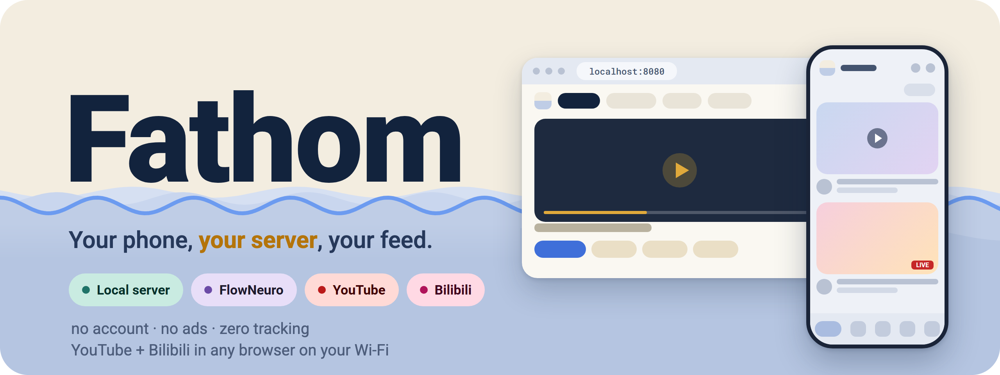
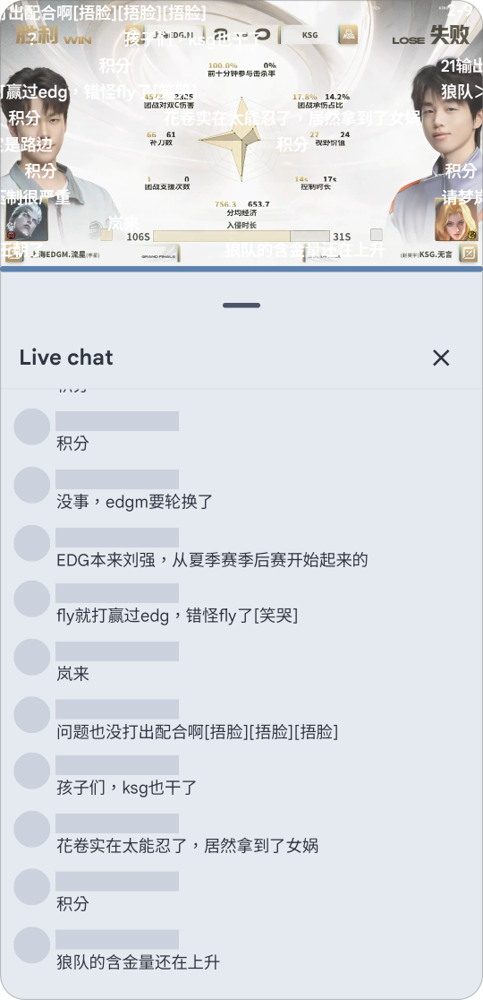
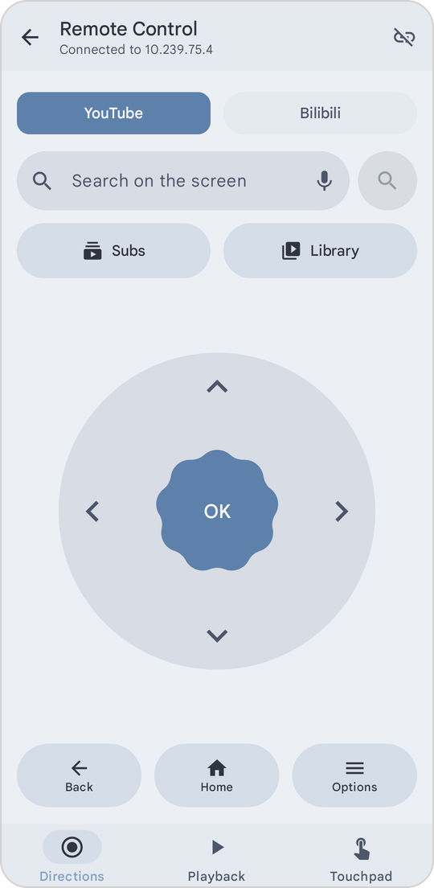
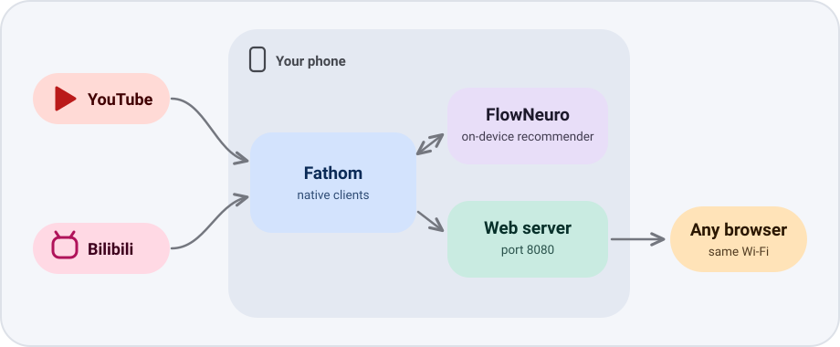

<p align="center">
  
</p>

<p align="center">
  <picture><source media="(prefers-color-scheme: dark)" srcset="Assets/badges/lang/english-current-dark.svg"></picture>
  <a href="README.zh-TW.md"><picture><source media="(prefers-color-scheme: dark)" srcset="Assets/badges/lang/chinese-dark.svg"></picture></a>
</p>

<p align="center">
  <a href="https://github.com/Chiehx0220/Fathom/releases"><picture><source media="(prefers-color-scheme: dark)" srcset="Assets/badges/pill/get-github-dark.svg"></picture></a>
  <a href="https://apps.obtainium.imranr.dev/redirect?r=obtainium://app/%7B%22id%22%3A%22io.github.chiehx0220.fathom%22%2C%22url%22%3A%22https%3A%2F%2Fgithub.com%2FChiehx0220%2FFathom%22%2C%22author%22%3A%22Chiehx0220%22%2C%22name%22%3A%22Fathom%22%2C%22preferredApkIndex%22%3A0%2C%22additionalSettings%22%3A%22%7B%5C%22includePrereleases%5C%22%3Atrue%7D%22%7D"><picture><source media="(prefers-color-scheme: dark)" srcset="Assets/badges/pill/get-obtainium-dark.svg"></picture></a>
</p>

<p align="center">
  <picture><source media="(prefers-color-scheme: dark)" srcset="Assets/badges/split/android-dark.svg"></picture>
  <a href="https://github.com/Chiehx0220/Fathom/releases"><picture><source media="(prefers-color-scheme: dark)" srcset="Assets/badges/split/release-dark.svg"></picture></a>
  <a href="https://github.com/Chiehx0220/Fathom/releases"><picture><source media="(prefers-color-scheme: dark)" srcset="Assets/badges/split/downloads-dark.svg"></picture></a>
  <a href="License"><picture><source media="(prefers-color-scheme: dark)" srcset="Assets/badges/split/license-dark.svg"></picture></a>
  <a href="#cert"><picture><source media="(prefers-color-scheme: dark)" srcset="Assets/badges/split/signed-dark.svg"></picture></a>
  <picture><source media="(prefers-color-scheme: dark)" srcset="Assets/badges/split/tracking-dark.svg"></picture>
  <a href="https://github.com/Flow-Tube/Flow"><picture><source media="(prefers-color-scheme: dark)" srcset="Assets/badges/split/fork-dark.svg"></picture></a>
</p>

---

<table>
  <tr>
    <td width="50%" valign="top"><b>🌐 Your phone is the server</b><br>Open it in any browser on your Wi-Fi. Nothing to install.</td>
    <td width="50%" valign="top"><b>📱 Your phone is the remote</b><br>Arrow pad, touchpad, quality, speed and voice search.</td>
  </tr>
  <tr>
    <td width="50%" valign="top"><b>🎬 Native Bilibili</b><br>Search, playback, comments, danmaku and live rooms. No web view.</td>
    <td width="50%" valign="top"><b>🧠 Recommends on the phone</b><br>FlowNeuro learns on the device. Nothing leaves it.</td>
  </tr>
  <tr>
    <td width="50%" valign="top"><b>🧩 Everything from Flow</b><br>YouTube, SponsorBlock, DeArrow and downloads.</td>
    <td width="50%" valign="top"><b>🔒 Nothing to sign up for</b><br>No account, no ads, no tracking.</td>
  </tr>
</table>

## 📸 Screenshots

<table>
  <tr>
    <td width="25%" align="center" valign="top"><br><sub>One feed for YouTube and Bilibili</sub></td>
    <td width="25%" align="center" valign="top"><br><sub>Watch page</sub></td>
    <td width="25%" align="center" valign="top"><br><sub>Bilibili live with danmaku</sub></td>
    <td width="25%" align="center" valign="top"><br><sub>Phone as a remote control</sub></td>
  </tr>
</table>

## 🏗 How it fits together

<p align="center">
  
</p>

## 🌐 Local web server

To watch on a computer, turn the server on and open it in any browser, with nothing to install. If you would rather have a dedicated desktop app, Flow's own [Flow-Desktop](https://github.com/Flow-Tube/Flow-Desktop) is another option. Subscriptions, history, and watch-later come straight from the app.

Once it is on, the phone serves a web app on port 8080.

- **On the phone itself:** `http://localhost:8080`
- **On any device on the same Wi-Fi:** `http://<phone-ip>:8080`, with nothing to install there

In the web app:

- Search, channels, playlists, subscriptions
- A Library page: history, watch-later, playlists and downloads
- Download from the watch page, choosing quality, format or audio only
- An Up next card that autoplays, with a switch to turn it off
- A [Video.js](https://videojs.org) 10 player, served from the device itself: quality menu, chapters, seek-bar thumbnails, subtitles, audio-only mode, shortcuts, resume
- YouTube and Bilibili playback, with danmaku

<p align="center">
  
</p>

> The web server and web page are inspired by [localtube](https://github.com/diekaiju/localtube) by diekaiju, rewritten for Fathom and extended with Bilibili.

### 🎮 Remote control

Away from the keyboard? Steer a Fathom screen from your phone instead.

- Arrow pad with OK, Back, Home and Options, plus a touchpad
- Playback controls, and shortcuts to Subscriptions and Library
- Search by typing or by voice
- A YouTube / Bilibili switch

## 🎬 Bilibili, natively

No web view. A Kotlin client talks to Bilibili's web API directly.

- Search, channels (uploads, series, seasons), playback, quality, multi-part videos
- Comments and danmaku, the comments that scroll across the video
- Subscriptions, history, likes and playlists, alongside YouTube's

## 🧠 FlowNeuro

Every recommendation comes from **FlowNeuro**, A-EDev's on-device engine from Flow.

- Learns from watches, skips, likes, searches, and how long you stay
- Spots when you're bored of a topic and mixes in something new
- Shows exactly what it knows about you, and lets you edit, export, or wipe it

**What Fathom adds:** Bilibili watches count toward the same profile as YouTube's, and a filter of Chinese filler words (我们, 这个, 大家 and the like) keeps them from showing up as topics. The engine itself is Flow's.

## 🔁 Bring your data

- **Import** NewPipe or PipePipe subscription JSON. Bilibili channels and avatars come along.
- **Export** the same JSON back to either app.

<a id="cert"></a>

## 🔏 Verify the download

Every APK on the [releases page](https://github.com/Chiehx0220/Fathom/releases) is signed with the same key, and the release workflow refuses to publish one signed with any other. To check that a file is Fathom's, compare its signing certificate with this fingerprint using [AppVerifier](https://github.com/soupslurpr/AppVerifier) or `apksigner`:

**Signing certificate SHA-256 fingerprint**

`2E:35:71:C4:F5:21:F7:1C:65:50:42:D9:D9:6F:BD:11:C2:95:B7:4E:28:8E:2F:31:72:66:CD:61:93:21:74:EA`

```bash
apksigner verify --print-certs fathom.apk
```

Each release also carries `checksums.txt`, so `sha256sum -c checksums.txt` confirms a download is whole.

## 🛠 Build

```bash
git clone https://github.com/Chiehx0220/Fathom.git
cd Fathom
./gradlew assembleGithubDebug
```

Signed APKs are on the [releases page](https://github.com/Chiehx0220/Fathom/releases), the newest stable release is marked Latest. Variants: `foss` (no updater), `nightly` (installs beside debug).

## 🧩 Under the hood

Paths are under `app/src/main/java/io/github/aedev/flow/`.

| Where | What |
|---|---|
| `bilibili/` | The client: API, request signing, sessions, live rooms, comments, danmaku, ids, deep links |
| `data/paging/`, `player/stream/`, `ui/screens/playlists/` (`Bilibili*`) | Mappers and glue that plug it into search, playback, and playlists |
| `di/BilibiliModule.kt` | One shared session for the whole app |
| `localserver/` | The web server, its Bilibili adapters, and the web player pages |
| about 130 upstream files | Small hooks, mostly passing a service id through |

The rule: new code goes in new files, and upstream files only get a call into it. That keeps merges from upstream small. [FORK-DIFF.md](FORK-DIFF.md) lists every upstream file touched (`node scripts/fork-diff.js`), and `bilibili/PPE-REFERENCE.md` records which PipePipeExtractor revision the client was ported from.

Everything else in Flow (SponsorBlock, DeArrow, music, Shorts, downloads, themes) is still here. See [upstream](https://github.com/A-EDev/Flow#features).

## 🤖 How Fathom is built

Fathom has been developed with AI assistance from the outset: Claude Code (Anthropic) has been used throughout development.

Direction and quality remain my responsibility. I define the goals and make the design decisions, I review each change, and I decide what is merged and released. No commit, push or release is made without my instruction.

Quality is safeguarded as follows: unit tests and CodeQL run on every push; a CI budget limits how much of upstream Flow's code Fathom changes (see [FORK-DIFF.md](FORK-DIFF.md)); and every user-visible change is tested on a physical phone before release.

## 🙏 Credits

[Flow](https://github.com/A-EDev/Flow) and FlowNeuro by A-EDev · [PipePipeExtractor](https://github.com/InfinityLoop1308/PipePipeExtractor) by InfinityLoop1308 (the Bilibili client is based on it) · [NewPipeExtractor](https://github.com/TeamNewPipe/NewPipeExtractor) · [localtube](https://github.com/diekaiju/localtube) by diekaiju · [Video.js](https://videojs.org) and [hls.js](https://github.com/video-dev/hls.js)

## 📄 License

Fathom is released under GPL-3.0. You are free to use, modify and share it, but any version you distribute must stay open source under the same license.

Flow, FlowNeuro included, is © 2025–2026 A-EDev. The changes and additions in Fathom are © 2026 Chiehx0220.
