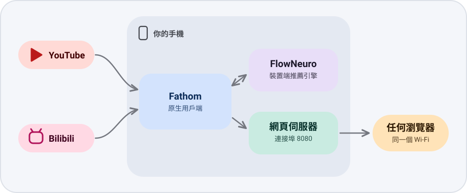

<p align="center">
  
</p>

<p align="center">
  <a href="README.md"><picture><source media="(prefers-color-scheme: dark)" srcset="Assets/badges/lang/english-dark.svg"></picture></a>
  <picture><source media="(prefers-color-scheme: dark)" srcset="Assets/badges/lang/chinese-current-dark.svg"></picture>
</p>

<p align="center">
  <a href="https://github.com/Chiehx0220/Fathom/releases"><picture><source media="(prefers-color-scheme: dark)" srcset="Assets/badges/pill/get-github-dark.svg"></picture></a>
  <a href="https://apps.obtainium.imranr.dev/redirect?r=obtainium://app/%7B%22id%22%3A%22io.github.chiehx0220.fathom%22%2C%22url%22%3A%22https%3A%2F%2Fgithub.com%2FChiehx0220%2FFathom%22%2C%22author%22%3A%22Chiehx0220%22%2C%22name%22%3A%22Fathom%22%2C%22preferredApkIndex%22%3A0%2C%22additionalSettings%22%3A%22%7B%5C%22includePrereleases%5C%22%3Atrue%7D%22%7D"><picture><source media="(prefers-color-scheme: dark)" srcset="Assets/badges/pill/get-obtainium-dark.svg"></picture></a>
</p>

<p align="center">
  <picture><source media="(prefers-color-scheme: dark)" srcset="Assets/badges/split/android-dark.svg"></picture>
  <a href="https://github.com/Chiehx0220/Fathom/releases"><picture><source media="(prefers-color-scheme: dark)" srcset="Assets/badges/split/release-dark.svg"></picture></a>
  <a href="https://github.com/Chiehx0220/Fathom/releases"><picture><source media="(prefers-color-scheme: dark)" srcset="Assets/badges/split/downloads-dark.svg"></picture></a>
  <a href="License"><picture><source media="(prefers-color-scheme: dark)" srcset="Assets/badges/split/license-dark.svg"></picture></a>
  <a href="#cert"><picture><source media="(prefers-color-scheme: dark)" srcset="Assets/badges/split/signed-dark.svg"></picture></a>
  <picture><source media="(prefers-color-scheme: dark)" srcset="Assets/badges/split/tracking-dark.svg"></picture>
  <a href="https://github.com/Flow-Tube/Flow"><picture><source media="(prefers-color-scheme: dark)" srcset="Assets/badges/split/fork-dark.svg"></picture></a>
</p>

---

<table>
  <tr>
    <td width="50%" valign="top"><b>🌐 手機就是伺服器</b><br>同一個 Wi-Fi 下任何瀏覽器都能開，電腦不用裝程式。</td>
    <td width="50%" valign="top"><b>📱 手機就是遙控器</b><br>方向鍵、觸控板、畫質、倍速與語音搜尋。</td>
  </tr>
  <tr>
    <td width="50%" valign="top"><b>🎬 原生 Bilibili</b><br>搜尋、播放、留言、彈幕與直播間，不是內嵌網頁。</td>
    <td width="50%" valign="top"><b>🧠 在手機上推薦</b><br>FlowNeuro 在裝置上學習，資料不會離開。</td>
  </tr>
  <tr>
    <td width="50%" valign="top"><b>🧩 Flow 的功能都在</b><br>YouTube、SponsorBlock、DeArrow 與下載。</td>
    <td width="50%" valign="top"><b>🔒 免註冊</b><br>免登入、無廣告、不追蹤。</td>
  </tr>
</table>

## 📸 截圖

<table>
  <tr>
    <td width="25%" align="center" valign="top"><br><sub>YouTube 與 Bilibili 同一個首頁</sub></td>
    <td width="25%" align="center" valign="top"><br><sub>播放頁</sub></td>
    <td width="25%" align="center" valign="top"><br><sub>Bilibili 直播與彈幕</sub></td>
    <td width="25%" align="center" valign="top"><br><sub>手機變遙控器</sub></td>
  </tr>
</table>

## 🏗 運作方式

<p align="center">
  
</p>

## 🌐 本機網頁伺服器

想在電腦上看片,開啟伺服器後用任何瀏覽器就能看,不需要安裝任何程式。如果你比較喜歡專用的桌面應用程式,也可以使用 Flow 官方的 [Flow-Desktop](https://github.com/Flow-Tube/Flow-Desktop)。訂閱、觀看紀錄和稍後觀看都直接取自 App。

開啟後,手機會在 8080 連接埠提供網頁版 App。

- **在手機上:** `http://localhost:8080`
- **同一個 Wi-Fi 下的任何裝置:** `http://<手機IP>:8080`,不需安裝任何東西

> **只能在私有網路使用。** 伺服器只回應同一個區域網路內的裝置(自己家的 Wi-Fi,或手機的熱點),網際網路和其他網站的網頁都連不進來。咖啡廳這類公共 Wi-Fi 通常不讓裝置互相連線,在那裡請讓電腦連上手機的熱點。想在外面使用,請用 Tailscale 之類的 VPN,不要對外開放連接埠。
>
> **配對碼。** 瀏覽器第一次開啟伺服器時，會要求輸入手機上顯示的 6 位數配對碼(在設定頁和遙控器畫面)，之後這個瀏覽器就維持已配對。按「重新產生」會讓所有瀏覽器登出。猜碼有限制：輸錯幾次，該裝置會被鎖定 10 分鐘。連線是明文 HTTP，同一個網路上有人側錄流量時仍可能看到配對碼，所以請只在信任的網路使用，用完就關。

- 搜尋、頻道、播放清單、訂閱
- 媒體庫頁面:觀看紀錄、稍後觀看、播放清單和下載
- 在觀看頁直接下載,可選畫質、格式或純音訊
- 「接著播放」卡片會自動播放,也能用開關關閉
- [Video.js](https://videojs.org) 10 播放器(由裝置本身提供,不需要外部 CDN):畫質選單、章節、進度條縮圖、字幕、純音訊模式、快捷鍵、接續播放
- 支援 YouTube 和 Bilibili,Bilibili 也能顯示彈幕

<p align="center">
  
</p>

> 內建伺服器與網頁版的靈感來自 diekaiju 的 [localtube](https://github.com/diekaiju/localtube),在 Fathom 中重新撰寫並擴充了 Bilibili 支援。

### 🎮 用手機遙控

不想碰鍵盤和滑鼠?也可以直接用手機來操作 Fathom 的畫面。

- 方向鍵搭配確認、返回、首頁和選項,另有觸控板
- 播放控制,以及訂閱、媒體庫的捷徑
- 可用打字或語音搜尋
- 能切換 YouTube 與 Bilibili

## 🎬 原生 Bilibili

不是內嵌網頁。由 Kotlin 寫成的用戶端直接呼叫 Bilibili 的網頁 API。

- 搜尋、頻道(投稿、系列、合集)、播放、畫質切換、多分 P
- 留言與彈幕
- 訂閱、觀看紀錄、按讚和播放清單,與 YouTube 並列管理

## 🧠 FlowNeuro

所有推薦都由 **FlowNeuro** 產生。它是 A-EDev 為 Flow 開發的推薦引擎,直接在手機上運算。

- 從你的觀看、跳過、按讚、搜尋和停留時間學習喜好
- 發現你對某個主題看膩了,就改推其他內容
- 它記錄了哪些關於你的資料,你都看得到,並且能自行編輯、匯出或一鍵清除

**Fathom 新增的部分:** 在 Bilibili 看的內容會和 YouTube 一起計入同一份個人檔案,另外加了一份中文虛詞過濾表(我們、這個、大家等),避免這些詞被當成主題。推薦引擎本身是 Flow 的。

## 🔁 搬移你的資料

- **匯入** NewPipe 或 PipePipe 的訂閱 JSON,Bilibili 頻道和頭像也會一起帶進來。
- **匯出**成相同格式的 JSON,可以再匯回這兩個 App。

<a id="cert"></a>

## 🔏 驗證下載的檔案

[Releases 頁面](https://github.com/Chiehx0220/Fathom/releases)上的每個 APK 都用同一把金鑰簽署,發布流程遇到其他金鑰簽的檔案會直接拒絕發布。想確認檔案真的是 Fathom 的,可以用 [AppVerifier](https://github.com/soupslurpr/AppVerifier) 或 `apksigner`,把簽署憑證與下面的指紋比對:

**簽署憑證 SHA-256 指紋**

`2E:35:71:C4:F5:21:F7:1C:65:50:42:D9:D9:6F:BD:11:C2:95:B7:4E:28:8E:2F:31:72:66:CD:61:93:21:74:EA`

```bash
apksigner verify --print-certs fathom.apk
```

每個版本也附有 `checksums.txt`,用 `sha256sum -c checksums.txt` 可以確認下載的檔案完整。

## 🛠 建置

```bash
git clone https://github.com/Chiehx0220/Fathom.git
cd Fathom
./gradlew assembleGithubDebug
```

已簽署的 APK 放在 [Releases 頁面](https://github.com/Chiehx0220/Fathom/releases),最新的穩定版標示為 Latest。可選的建置變體:`foss`(不含自動更新)、`nightly`(可與 debug 版並存安裝)。

## 🧩 程式碼結構

路徑都在 `app/src/main/java/io/github/aedev/flow/` 底下。

| 位置 | 內容 |
|---|---|
| `bilibili/` | 用戶端本體:API、請求簽章、登入狀態、直播、留言、彈幕、影片 ID、連結開啟 |
| `data/paging/`、`player/stream/`、`ui/screens/playlists/`(`Bilibili*`) | 把 Bilibili 接進搜尋、播放和播放清單的轉換與銜接程式碼 |
| `di/BilibiliModule.kt` | 整個 App 共用同一個登入狀態 |
| `localserver/` | 網頁伺服器、Bilibili 轉接層,以及網頁播放器頁面 |
| 約 130 個上游檔案 | 小幅改動,多半只是多傳一個服務代碼 |

原則:新程式碼一律放在新檔案,上游檔案只加一行呼叫,這樣同步上游時衝突會少很多。[FORK-DIFF.md](FORK-DIFF.md) 列出所有改動過的上游檔案(由 `node scripts/fork-diff.js` 產生);`bilibili/PPE-REFERENCE.md` 記錄用戶端是從 PipePipeExtractor 的哪個版本移植而來。

Flow 原有的功能(SponsorBlock、DeArrow、音樂、Shorts、下載、主題)全部保留,詳見[上游說明](https://github.com/A-EDev/Flow#features)。

## 🤖 開發方式

本專案自開發之初即採用 AI 輔助,全程使用 Claude Code(Anthropic)協助開發。

專案方向與品質由我負責:開發目標與設計決策由我決定,各項變更由我審查,合併與發布亦由我裁定。未經我的指示,不會進行任何提交、推送或發布。

品質把關方面:每次推送皆執行單元測試與 CodeQL 檢查;並以 CI 預算限制 Fathom 對上游 Flow 程式碼的改動幅度(詳見 [FORK-DIFF.md](FORK-DIFF.md));凡使用者可見的變更,於發布前均會在實體手機上實際測試。

## 🙏 致謝

[Flow](https://github.com/A-EDev/Flow) 與 FlowNeuro,A-EDev · [PipePipeExtractor](https://github.com/InfinityLoop1308/PipePipeExtractor),InfinityLoop1308(Bilibili 用戶端以它為基礎) · [NewPipeExtractor](https://github.com/TeamNewPipe/NewPipeExtractor) · [localtube](https://github.com/diekaiju/localtube),diekaiju · [Video.js](https://videojs.org) 與 [hls.js](https://github.com/video-dev/hls.js)

## 📄 授權

Fathom 以 GPL-3.0 授權釋出。你可以自由使用、修改和分享,但只要公開發佈,就必須連同原始碼一併開放,並沿用相同的授權。

Flow(含 FlowNeuro)© 2025–2026 A-EDev;Fathom 修改與新增的部分 © 2026 Chiehx0220。
